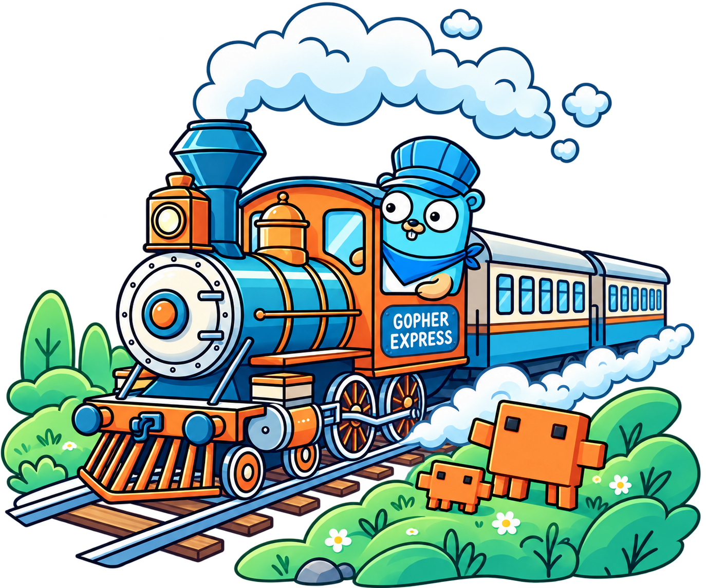

# go-train-skills

Repository with architecture tips and go-train tool skill for Claude.

Includes:
- Service architecture guidelines
- Coding agents guidelines (writing, review error surfacing, agentic loops)
- Go-Train framework usage guidelines
