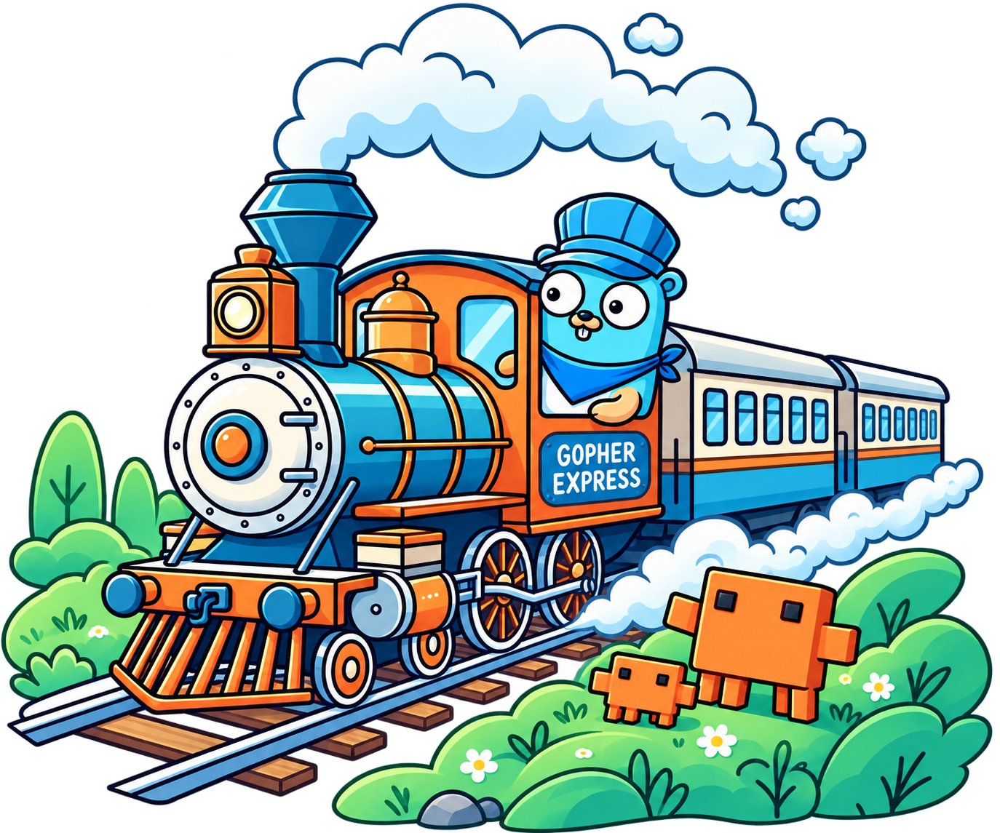

# go-train-skills



Repository with architecture tips and go-train tool skill for Claude.

Includes:
- Service architecture guidelines
- Coding agents guidelines (writing, review error surfacing, agentic loops)
- Go-Train framework usage guidelines

## Install in another repo

This repo is a Claude Code plugin and its own marketplace.

In Claude Code, inside the repo where you want the skills:

```
/plugin marketplace add Shitcode-Swamp/go-train-skills
/plugin install go-train-skills@go-train-skills
```

Pick the **project** scope to share it with everyone working in that repo (it's saved to `.claude/settings.json`), or **user** scope to have it in all your repos. Restart Claude Code after installing.

Get updates with `/plugin marketplace update go-train-skills`.

To try local changes without installing: `claude --plugin-dir /path/to/go-train-skills`.

## Contents

- `agents/`: `planner`, `go-test-writer`, `coder`, `reviewer`, `attention-gatherer`
- `skills/dev-loop`: how the main chat runs the agents
- `skills/`: code style (`minimal-comments`, `go-naming`, `go-nesting-depth`, `go-oop`, `go-interfaces`) and architecture (`service-layers`, `go-train-di`, `go-train-controller`, `go-train-repository`)

To always run the loop in a repo, add this line to its `CLAUDE.md`:

```
For non-trivial Go tasks, follow the go-train-skills:dev-loop skill.
```
